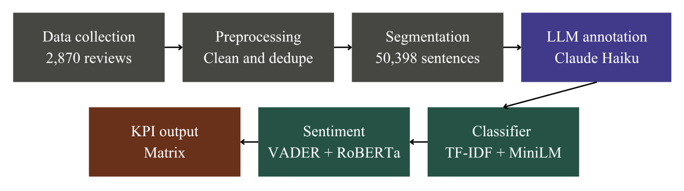
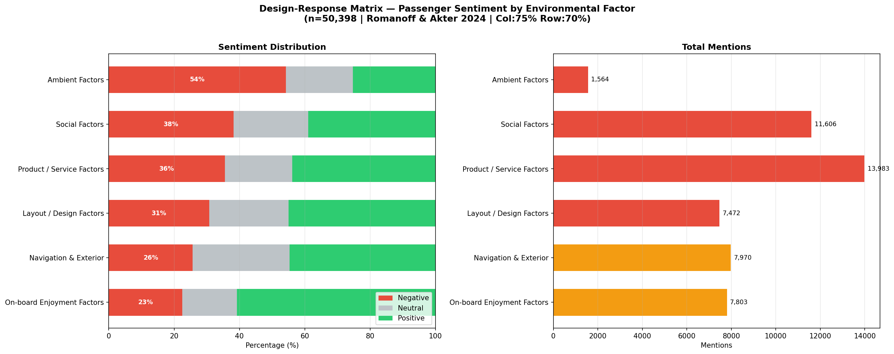
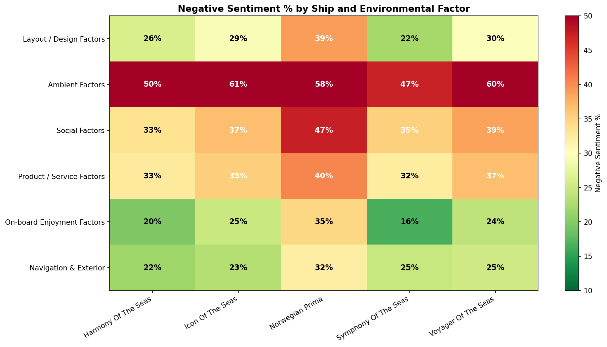

# NEXUS Pipeline

**NLP-driven Experienscape Understanding System** — an end-to-end NLP pipeline that converts unstructured cruise passenger reviews into structured engineering KPIs for naval architects.

Reference implementation for the Master's thesis:

> Özen, U. (2026). *Automated Analysis of Cruise Passenger Experiences: A Natural Language Processing Approach to Ship Design Optimization* [Master's thesis, Aalto University, School of Engineering]. Aaltodoc: https://urn.fi/URN:NBN:fi:aalto-202608186156

Developed within the **CruiseFlex — Design for a Sustainable Lifecycle** project, funded by Business Finland (3179/31/2025).

## What it does

Each review sentence is placed into a 6×4 **Design-Response Matrix** — the five environmental factors of Akter & Romanoff (2024) plus a sixth column, *Navigation & Exterior*, proposed in the thesis — crossed with the four internal response types of Pizam & Tasci (2019), and sentiment-scored by a VADER + RoBERTa ensemble. The pipeline runs in seven stages:

| Stage | What happens | Thesis RQ |
|---|---|---|
| 1 | Data loading, cleaning, language filtering, deduplication | RQ1 |
| 2 | spaCy sentence segmentation + MiniLM-L6-v2 embeddings | RQ1 |
| 3 | LLM-supervised annotation of ~2,500 sentences (Claude Haiku 4.5) | RQ2 |
| 3b | Human ground-truth validation (150-sentence stratified sample) | RQ2 |
| 4 | Hybrid classifier training (TF-IDF + embeddings, Logistic Regression) + ablation + McNemar | RQ2 |
| 5 | Full-corpus classification + confidence analysis (0.60 dual threshold) | RQ2 |
| 6 | VADER + RoBERTa sentiment ensemble with confidence tiers | RQ3 |
| 7 | 6×4 KPI matrices (Excel), charts, summary report | RQ4 |



## Key results (thesis dataset: 2,870 reviews → 50,398 sentences, five vessels)



*Fleet-wide sentiment by environmental factor (thesis Figure 10). Ambient Factors — noise, vibration, HVAC, air quality — is the only net-negative category (54.2% negative) despite being the least mentioned (3.1% of sentences): a "low volume, high severity" engineering priority.*



*Negative-sentiment percentage by ship and factor (thesis Figure 11). Norwegian Prima is the clearest fleet outlier, driven by Layout/Design and Social Factors.*

## Repository structure

```
nexus_pipeline.py        End-to-end pipeline (Stages 1–7)
requirements.txt         Python dependencies
data/sample_reviews.csv  Synthetic sample showing the input format
figures/                 Charts from the thesis run (01–07)
docs/                    Pipeline architecture diagram
outputs/                 Created at runtime (git-ignored)
```

## Installation

```bash
pip install -r requirements.txt
python -m spacy download en_core_web_sm      # also auto-downloaded at Stage 2
export ANTHROPIC_API_KEY=sk-ant-...          # needed only for Stage 3 annotation
```

## Usage

```bash
export NEXUS_DATA=path/to/reviews.csv        # default: data/reviews.csv
export NEXUS_OUTPUT=outputs                  # default: outputs
python nexus_pipeline.py
```

Input CSV format (see `data/sample_reviews.csv`):

| Column | Required | Notes |
|---|---|---|
| `ship_name` | yes | Free text; CruiseCritic-style names are normalised automatically |
| `review_body` | yes | ≥ 80 characters after cleaning; longer than 4,000 characters is truncated |
| `source` | no | Platform label; defaults to `unknown` |

Notes:
- Stage 3 caches annotations to `outputs/annotation_cache.csv` every 100 requests, so an interrupted run resumes without re-annotating. Without an API key, cached annotations are used if present.
- Stage 3b writes `human_annotation_task.csv`; fill in `human_col` / `human_row` and save as `human_labels.csv` to enable the Claude-vs-human agreement metrics on the next run.
- A GPU speeds up embeddings and RoBERTa considerably but is not required.

## Outputs

| File | Content | Thesis figure |
|---|---|---|
| `output_matrix.xlsx` | 6×4 KPI matrix, full dataset + per-ship sheets (aggregate counts only) | Figure 9 (single-ship example) |
| `output_matrix_highconf.xlsx` | Same, high-confidence subset | — |
| `01_sentiment_distribution.png` | Sentiment by environmental factor | Figure 10 |
| `02_ship_heatmap.png` | Negativity % by ship × factor | Figure 11 |
| `03_row_distribution.png` | Internal response distribution | Figure 5 |
| `04_model_agreement.png` | VADER vs RoBERTa agreement by column | Figure 8 |
| `05_classifier_accuracy.png` | Per-class classifier accuracy | Figure 7 |
| `06_baseline_comparison.png` | Feature ablation study | Figure 6 |
| `07_confidence_analysis.png` | Confidence distributions + full vs high-conf KPI | Figure 12 |
| `summary_report.txt` | Run summary (metrics, priorities, ship comparison) | — |
| `sentences.csv`, `labeled_dataset.csv`, `classified_*.csv`, `test_set_results.csv` | Sentence-level working files — **contain review text, git-ignored, not redistributed** | — |

## Reproducibility notes

- **Annotator model is pinned** to `claude-haiku-4-5-20251001`. LLM outputs are treated as pseudo-labels and were validated against a 150-sentence human-annotated sample (thesis Section 4.2); LLM calls are not fully deterministic, so re-annotation may differ marginally.
- **TF-IDF fit caveat:** the vectoriser is fitted on the full labelled set before the train/test split, exactly as in the thesis run. This is acknowledged in thesis Section 5.3 (~2–3 pp optimism for the baseline) and kept as-run so the published numbers reproduce exactly.
- The human validation was a single-annotator check (thesis Sections 4.2 and 5.3).
- Random seeds are fixed (`random_state=42`) for all stochastic sklearn/numpy steps.

## Data availability and ethics

Raw reviews were collected from the publicly accessible parts of TripAdvisor and CruiseCritic and are **not redistributed** with this repository (platform terms of service; GDPR data minimisation — thesis Section 3.1). User identifiers were dropped during preprocessing and results are reported at aggregate level only. The pipeline runs on any corpus meeting the input format above; a synthetic sample is provided for format reference. Generated working files containing review sentences are git-ignored and must not be pushed.

## Citation

See `CITATION.cff`, or cite the thesis directly (reference at the top of this README).

## License

MIT — see `LICENSE`.

## Acknowledgements

Thesis supervisor: Asst. Prof. Mashrura Musharraf. Advisors: Prof. Jani Romanoff and Doctoral Researcher Adanna Okonkwo (Aalto University). Funded via the CruiseFlex project (Business Finland, 3179/31/2025).

Generative AI use: Claude Haiku (Anthropic) served as the Stage-3 automated annotator; Claude was additionally used to assist with code documentation and consistency checks. All outputs were reviewed by the author, who takes full responsibility for the final content (see the thesis "Declaration on the Use of Generative AI").
